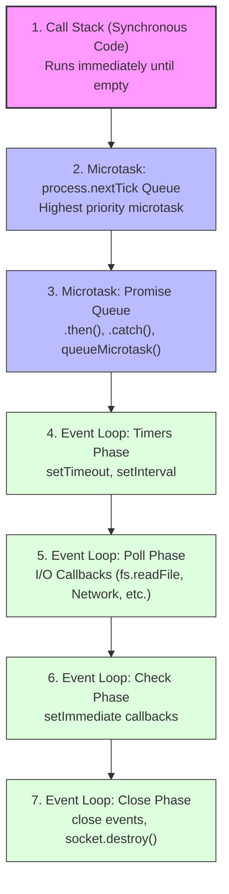

# Understanding the Node.js Event Loop (Simple & Visual Guide)

This guide explains how the **Node.js Event Loop** works under the hood in plain, simple English, using the exact code from [`event-loop.js`](file:///c:/Users/codet/OneDrive/Desktop/Training/node/event-loop.js).

---

## 1. What is the Event Loop? (The Simple Analogy)

JavaScript is **single-threaded** — it has only **one Call Stack** and can execute only one piece of code at a time.

Imagine a restaurant with:
- **One Head Chef (The Call Stack / Main Thread):** Prepares orders and executes instructions one by one.
- **Kitchen Assistants (libuv / Thread Pool / OS):** Handles slow, heavy tasks in the background (like reading files from disk, timers, network requests).
- **Order Slips (Queues):** Callbacks waiting to be processed once the background work is done.
- **The Event Loop Manager:** A continuous loop that watches: *"Is the Head Chef done with current work? If yes, grab the highest-priority order slip and hand it to the chef!"*

---

## 2. Priority Hierarchy: Who Runs First?

Node.js executes code in a strict order of priority:



> [!IMPORTANT]
> **The Microtask Rule:**  
> Whenever the Call Stack becomes empty — **before** entering the Event Loop or **between** any phase of the Event Loop — Node.js **MUST drain all Microtasks** first!
> 1. `process.nextTick` queue runs first (and empties completely).
> 2. Promise queue (`Promise.resolve().then(...)`) runs second.

---

## 3. The Code Under Test (`event-loop.js`)

```javascript
const fs = require("fs");

setImmediate(() => console.log("setImmediate log"));
setTimeout(() => console.log("Timer Expired"));

Promise.resolve().then(() => {
  process.nextTick(() => console.log("Promise Has Tick Log"));
  console.log("Promise Log");
});

fs.readFile("./file.txt", "utf-8", () => console.log("File Reading CB"));

process.nextTick(() => {
  process.nextTick(() => console.log("Inner Tick Log"));
  Promise.resolve().then(() => console.log("2nd Promise Log"));
  console.log("Tick Log");
});

console.log("Last Line of the code");
```

---

## 4. Execution Output

When you run `node event-loop.js`, the exact output is:

```text
Last Line of the code
Tick Log
Inner Tick Log
Promise Log
2nd Promise Log
Promise Has Tick Log
Timer Expired
File Reading CB
setImmediate log
```

---

## 5. Step-by-Step Walkthrough: Why This Exact Order?

Let's trace how Node.js reads and executes the code line by line.

### Phase 0: Synchronous Registration (Call Stack)

Node.js executes top-to-bottom synchronously:

1. **Line 3 (`setImmediate`):**  
   Registers a callback into the **Check Phase** queue.
2. **Line 4 (`setTimeout`):**  
   Registers a callback into the **Timers Phase** queue (default delay is 1ms).
3. **Lines 6–9 (`Promise.resolve().then`):**  
   The promise resolves immediately, so its `.then(...)` callback is pushed to the **Promise Microtask Queue**.
4. **Line 11 (`fs.readFile`):**  
   Delegated to the background libuv thread pool for asynchronous file reading.
5. **Lines 13–17 (`process.nextTick`):**  
   Pushes the outer `nextTick` callback into the **`nextTick` Microtask Queue**.
6. **Line 19 (`console.log("Last Line of the code")`):**  
   Synchronous function executed directly on the Call Stack!
   
   👉 **Output 1:** `Last Line of the code`

---

### Phase 1: Draining Microtasks (Before Event Loop Starts)

The Call Stack is now empty. Node.js pauses before entering the Event Loop phases to drain all microtasks.

#### Step 1A: Process `nextTick` Queue (Priority 1)

The queue contains the outer `nextTick` callback from line 13:
- Line 14: `process.nextTick(() => console.log("Inner Tick Log"))` is called  
  ➡️ Adds a new callback to the **`nextTick` Queue**.
- Line 15: `Promise.resolve().then(() => console.log("2nd Promise Log"))` is called  
  ➡️ Adds another callback to the **Promise Queue**.
- Line 16: `console.log("Tick Log")` executes immediately.  
  👉 **Output 2:** `Tick Log`

> **Key Rule:** Node.js empties the entire `nextTick` queue before looking at promises!  
Because `Inner Tick Log` was added to `nextTick`, Node executes it next:

- Callback for `Inner Tick Log` executes.  
  👉 **Output 3:** `Inner Tick Log`

Now the `nextTick` queue is completely empty.

---

#### Step 1B: Process Promise Microtask Queue (Priority 2)

Node now turns to the Promise queue, which currently contains:
1. The first promise callback (from lines 6–9)
2. The 2nd promise callback (from line 15)

**Executing 1st Promise Callback:**
- Line 7: `process.nextTick(() => console.log("Promise Has Tick Log"))`  
  ➡️ Pushes a new callback into the **`nextTick` Queue**.
- Line 8: `console.log("Promise Log")` executes.  
  👉 **Output 4:** `Promise Log`

**Executing 2nd Promise Callback:**
- Line 15: `console.log("2nd Promise Log")` executes.  
  👉 **Output 5:** `2nd Promise Log`

#### Step 1C: Draining Remaining Microtasks
Before Node moves on, it checks if any microtasks were created while running the promises.  
Yes! Line 7 scheduled a `process.nextTick`:
- Callback executes: `console.log("Promise Has Tick Log")`.  
  👉 **Output 6:** `Promise Has Tick Log`

All microtask queues are now empty!

---

### Phase 2: Event Loop Phases (Macrotasks)

Now the Event Loop kicks into gear through its cyclic phases:

```
[ Timers Phase ] ➡️ [ Poll Phase (I/O) ] ➡️ [ Check Phase ] ➡️ [ Close Phase ]
```

#### Phase 2A: Timers Phase
- Checks for expired timers. The `setTimeout(() => console.log("Timer Expired"))` (threshold 1ms) has expired.
- Its callback executes.  
  👉 **Output 7:** `Timer Expired`

#### Phase 2B: Poll Phase (I/O Callbacks)
- The background thread pool finished reading `./file.txt` (or encountered the error that it doesn't exist, passing `err` to the callback).
- The completion callback is ready in the Poll queue.
- Its callback executes.  
  👉 **Output 8:** `File Reading CB`

#### Phase 2C: Check Phase
- The Event Loop moves to the Check phase where `setImmediate` callbacks live.
- The callback from line 3 executes.  
  👉 **Output 9:** `setImmediate log`

The queues are now empty, no background handles remain, and the Node.js process exits cleanly!

---

## 6. Quick Reference Cheat Sheet

| Mechanism | Belongs To | When It Runs | Example in Code |
| :--- | :--- | :--- | :--- |
| **Call Stack** | Synchronous JS | **Immediately** | `console.log("Last Line...")` |
| **`process.nextTick`** | Microtask | After current call stack, **before** promises | `Tick Log`, `Inner Tick Log` |
| **Promise `.then()`** | Microtask | After all `nextTick`s, **before** event loop | `Promise Log`, `2nd Promise Log` |
| **`setTimeout`** | Event Loop (Timers) | When timer duration expires | `Timer Expired` |
| **`fs.readFile`** | Event Loop (Poll) | When I/O / file operation completes | `File Reading CB` |
| **`setImmediate`** | Event Loop (Check) | In the Check phase after Poll | `setImmediate log` |

---

## 7. Golden Rules to Remember

1. **Synchronous code always wins:** No callback can interrupt code currently running on the Call Stack.
2. **`nextTick` is king of microtasks:** `process.nextTick` always runs before Promise `.then()`, even if the promise was created earlier in the file.
3. **Microtasks starve the Event Loop:** If you recursively call `process.nextTick`, the Event Loop will never reach timers or I/O callbacks!
4. **`setImmediate` vs `setTimeout(..., 0)`:**
   - Inside an I/O callback (like inside `fs.readFile`), `setImmediate` is **guaranteed** to run before `setTimeout`.
   - At the top-level script, their order depends on execution speed and timer quantization (1ms min).

