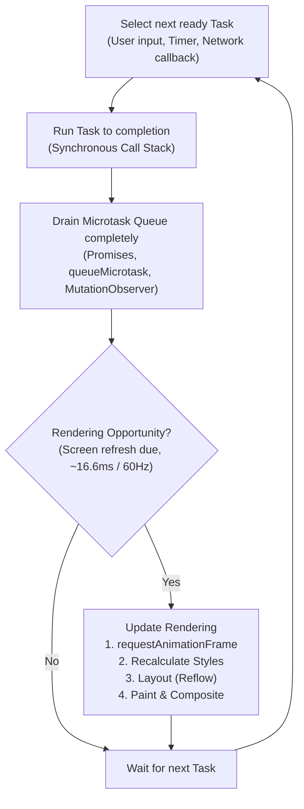
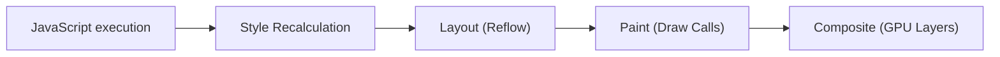

# Browser Event Loop: A Deep, Practical Guide

The **browser event loop** is the coordination system that allows JavaScript to perform useful work without freezing the web page. Although JavaScript traditionally runs on a single main thread, web applications can seamlessly respond to user clicks, animate elements at 60+ FPS, fetch remote data, update the DOM, and process timers.

The event loop coordinates these activities by determining **when JavaScript executes**, **when browser tasks run**, and **when the screen is painted**.

---

## High-Level Mental Model



> [!NOTE]
> JavaScript is single-threaded and executes one function at a time via the **Call Stack**. However, the browser environment is multi-threaded: Web APIs, network sockets, timers, and GPU compositors run in parallel in the background, queuing tasks for the main thread when work completes.

---

## 1. The Basic Idea

JavaScript executes code line by line on a single thread. The **Call Stack** tracks active function executions:
- Calling a function pushes a new stack frame.
- Returning from a function pops the stack frame.
- The engine cannot start another JavaScript task in the same context while the current stack is executing.

### The Continuous Event Loop Cycle
1. **Select** a ready task (such as a click or timer callback).
2. **Run** that task to completion (run-to-completion guarantee).
3. **Drain** the microtask queue completely.
4. **Render** if appropriate (styles, layout, painting, compositing).
5. **Repeat** with the next cycle.

---

## 2. The Call Stack

Consider this synchronous flow:

```javascript
function first() {
  second();
}

function second() {
  console.log("running");
}

first();
```

### Stack Lifecycle
1. Global script execution begins on the Call Stack.
2. `first()` is invoked $\rightarrow$ `first` is pushed onto the stack.
3. Inside `first()`, `second()` is invoked $\rightarrow$ `second` is pushed onto the stack.
4. `console.log("running")` executes.
5. `second()` returns $\rightarrow$ popped from the stack.
6. `first()` returns $\rightarrow$ popped from the stack.
7. Global script finishes.

### Blocking the Stack

Because the Call Stack is synchronous and single-threaded, long computations monopolize the thread:

```javascript
const end = performance.now() + 3000;
while (performance.now() < end) {
  // Deliberately blocks the main thread for 3 seconds
}
```

> [!WARNING]
> During those 3 seconds, user clicks cannot be handled, timers cannot fire, animations freeze, and the page cannot repaint. "Asynchronous" does not mean parallel code execution on the main thread; background callbacks cannot preempt currently running synchronous code.

---

## 3. Tasks (Macrotasks)

A **Task** is a self-contained unit of work scheduled on the event loop.

### Common Sources of Tasks
- Initial `<script>` tag execution.
- `setTimeout` and `setInterval` callbacks.
- User input events (clicks, keypresses, mouse events).
- Network completion events (`fetch` completion, `XMLHttpRequest` callbacks).
- Cross-document messaging (`window.postMessage`, `MessageChannel`).
- File and device notification events.

Each task runs as an uninterrupted turn. The browser cannot render or handle user input while a task is executing.

### How Timers Actually Work

A timer does **not** mean *"run exactly after $X$ ms"*; it means *"do not run before $X$ ms"*. Once the delay expires, the browser queues the callback into the timer task source:

```javascript
console.log("A");

setTimeout(() => {
  console.log("timer");
}, 0);

console.log("B");
```

**Output:**
```text
A
B
timer
```

A delay of `0ms` does not make execution synchronous. The current script task must finish before the timer task can be picked up.

---

## 4. Microtasks

**Microtasks** are high-priority deferred tasks processed immediately after the active JavaScript Call Stack empties, **before** the browser yields to the next task or renders.

### Common Sources of Microtasks
- Promise callbacks (`.then()`, `.catch()`, `.finally()`).
- `async` function continuations after an `await`.
- Explicit queuing via `queueMicrotask(() => { ... })`.
- `MutationObserver` DOM mutation callbacks.

### Execution Order Example

```javascript
console.log("A");

queueMicrotask(() => {
  console.log("microtask");
});

console.log("B");
```

**Output:**
```text
A
B
microtask
```

### Microtasks vs. Timers

```javascript
setTimeout(() => console.log("timer"), 0);
Promise.resolve().then(() => console.log("promise"));
```

**Output:**
```text
promise
timer
```

The microtask queue is drained before the browser picks up the next task from the timer queue.

---

## 5. Why Microtasks Can Starve the Browser

Because the event loop drains the microtask queue until it is completely empty, scheduling microtasks recursively blocks both tasks and rendering:

```javascript
function keepGoing() {
  queueMicrotask(keepGoing); // Infinite microtask recursion!
}

keepGoing();
```

> [!CAUTION]
> This creates an infinite microtask loop. The browser will never reach the rendering phase, freezing the user interface entirely.

### Solution: Chunking Heavy Work
Break large arrays or calculations into chunks and yield back to the event loop using tasks:

```javascript
function processChunk(items, index = 0) {
  const limit = Math.min(index + 100, items.length);

  for (let i = index; i < limit; i += 1) {
    processItem(items[i]);
  }

  if (limit < items.length) {
    // Yield to the event loop so the browser can repaint and handle input
    setTimeout(() => processChunk(items, limit), 0);
  }
}
```

In modern browsers, you can also use `await scheduler.yield()` or `requestIdleCallback`.

---

## 6. Promises and `async` / `await`

Promise handlers are asynchronous microtasks; they are not executed synchronously when a promise resolves:

```javascript
const promise = Promise.resolve("ready");

promise.then(value => console.log(value));
console.log("after registration");
```

**Output:**
```text
after registration
ready
```

### How `await` Behaves

An `async` function runs synchronously until its first `await` suspension point:

```javascript
async function example() {
  console.log("inside 1");
  await Promise.resolve();
  console.log("inside 2");
}

console.log("before");
example();
console.log("after");
```

**Output:**
```text
before
inside 1
after
inside 2
```

> [!TIP]
> `await` does not create a background thread. It pauses the function and schedules everything below the `await` as a microtask continuation.

---

## 7. Rendering and Painting

The event loop is not just a JavaScript queue; it also gates screen updates:



1. **JavaScript:** DOM or CSSOM mutations occur.
2. **Style:** Computes which CSS rules apply to which elements.
3. **Layout:** Computes element bounding boxes, coordinates, and geometry.
4. **Paint:** Generates draw instructions (colors, borders, shadows).
5. **Composite:** Uploads layer bitmaps to the GPU to draw onto the display.

At a 60Hz display refresh rate, the browser has roughly **16.67 milliseconds per frame** to execute JavaScript, process input, calculate styles, layout, and paint.

---

## 8. `requestAnimationFrame` (rAF)

`requestAnimationFrame` schedules work to run immediately **before the next browser repaint**, synchronizing directly with the display refresh rate:

```javascript
let lastTime;
let x = 0;
const box = document.querySelector("#box");

function frame(time) {
  if (lastTime !== undefined) {
    const delta = time - lastTime;
    x += 0.1 * delta; // Frame-rate independent animation
    box.style.transform = `translateX(${x}px)`;
  }

  lastTime = time;
  if (x < 400) {
    requestAnimationFrame(frame);
  }
}

requestAnimationFrame(frame);
```

> [!NOTE]
> Always compute movement based on elapsed `delta` time rather than fixed increments, because frame intervals vary and background tabs throttle rAF callbacks to conserve battery and CPU.

---

## 9. Input Responsiveness: Debounce & Throttle

Input events arrive as tasks. If the main thread is busy with long tasks, input latency occurs.

### Debouncing (Wait Until Activity Stops)
Ideal for search input fields and auto-save:

```javascript
let timeoutId;

input.addEventListener("input", event => {
  clearTimeout(timeoutId);
  timeoutId = setTimeout(() => search(event.target.value), 250);
});
```

### Throttling (Cap Execution Rate)
Ideal for scroll or resize events:

```javascript
let scheduled = false;

window.addEventListener("scroll", () => {
  if (scheduled) return;
  scheduled = true;

  requestAnimationFrame(() => {
    scheduled = false;
    updateScrollIndicator();
  });
}, { passive: true });
```

---

## 10. Web APIs & JavaScript Engine Interaction

The JavaScript engine (V8, JavaScriptCore, SpiderMonkey) does not handle timers or networking directly. It delegates them to **Browser Web APIs**:

```javascript
fetch("/api/data")
  .then(response => response.json())
  .then(data => render(data))
  .catch(error => showError(error));
```

- The HTTP connection, TLS handshake, and packet streaming occur off the main thread in native browser networking threads.
- Once bytes arrive, the browser queues a promise resolution microtask.
- The `render(data)` callback executes on the JavaScript main thread.

---

## 11. Complete Ordering Master Example

Trace the execution order of this snippet:

```javascript
console.log("script start");

setTimeout(() => console.log("timer"), 0);

Promise.resolve().then(() => {
  console.log("promise 1");
  queueMicrotask(() => console.log("nested microtask"));
});

queueMicrotask(() => console.log("microtask 2"));

console.log("script end");
```

### Execution Output
```text
script start
script end
promise 1
microtask 2
nested microtask
timer
```

### Detailed Order Breakdown
1. **Synchronous Script Task:**
   - Prints `"script start"`.
   - Schedules `"timer"` in the Macrotask (Timer) queue.
   - Schedules `"promise 1"` in the Microtask queue.
   - Schedules `"microtask 2"` in the Microtask queue.
   - Prints `"script end"`.
2. **Draining Microtask Queue:**
   - Executes `"promise 1"` callback $\rightarrow$ logs `"promise 1"` and pushes `"nested microtask"` to the end of the microtask queue.
   - Executes `"microtask 2"` callback $\rightarrow$ logs `"microtask 2"`.
   - Executes newly queued `"nested microtask"` $\rightarrow$ logs `"nested microtask"`.
3. **Next Task:**
   - Event loop picks the timer task $\rightarrow$ logs `"timer"`.

---

## 12. Tasks vs. Microtasks vs. rAF vs. Workers

| Mechanism | Queue Type | Runs When | Best Used For |
| :--- | :--- | :--- | :--- |
| **Synchronous** | Call Stack | Immediately | Ordinary business logic, computations |
| **Microtask** | Microtask Queue | Immediately after call stack empties, before tasks/rendering | State updates, Promise resolutions, cleanup |
| **`requestAnimationFrame`** | Animation Callback | Right before the next screen repaint | DOM styles, canvas drawing, smooth animations |
| **Task (`setTimeout`)** | Macrotask Queue | In a future turn, after microtasks and rendering | Chunking large jobs, deferred non-critical work |
| **Web Worker** | Background Thread | Concurrently in a separate thread | Heavy math, image/audio processing, big data parsing |

---

## 13. Web Workers: Offloading Heavy Computation

Web Workers run on separate OS threads, isolated from the DOM and window object:

### `main.js`
```javascript
const worker = new Worker("worker.js");

worker.postMessage(largeInput);

worker.addEventListener("message", event => {
  displayResult(event.data);
});
```

### `worker.js`
```javascript
self.addEventListener("message", event => {
  const result = expensiveCalculation(event.data);
  self.postMessage(result);
});
```

---

## 14. Layout Thrashing (Forced Synchronous Layout)

Alternating between writing to the DOM and reading layout geometry forces immediate, synchronous recalculations:

### ❌ Inefficient: Alternating Reads and Writes
```javascript
for (const item of items) {
  item.style.width = item.offsetWidth + 10 + "px"; // Read + Write triggers layout on every loop!
}
```

### ✅ Optimized: Batch Reads, Then Batch Writes
```javascript
const widths = items.map(item => item.offsetWidth); // Batch reads first

items.forEach((item, index) => {
  item.style.width = widths[index] + 10 + "px";      // Batch writes second
});
```

---

## 15. Long Tasks (> 50ms)

A **Long Task** is any main-thread task taking longer than **50 milliseconds**. Long tasks directly cause sluggish user interactions and missed frames.

You can observe long tasks programmatically using the `PerformanceObserver`:

```javascript
const observer = new PerformanceObserver(list => {
  for (const entry of list.getEntries()) {
    console.warn("Long task detected:", entry.duration, "ms");
  }
});

observer.observe({ type: "longtask", buffered: true });
```

---

## 16. Common Misconceptions Debunked

- ❌ *"JavaScript runs in parallel on the webpage."*  
  ✔️ **Reality:** Main-thread JavaScript is strictly single-threaded and sequential. Only Web Workers and internal browser subsystems run in parallel.
- ❌ *"`setTimeout(..., 0)` runs immediately."*  
  ✔️ **Reality:** It queues a macrotask for a future turn, subject to clamping (minimum 4ms after 5 nested calls) and earlier queued tasks.
- ❌ *"Promises are faster than timers."*  
  ✔️ **Reality:** Promises run in the microtask queue, which drains earlier than timer tasks, but they execute on the exact same thread.
- ❌ *"`await` freezes the browser."*  
  ✔️ **Reality:** `await` pauses only the async function, yielding control back to the event loop.
- ❌ *"The browser repaints after every line of DOM code."*  
  ✔️ **Reality:** Browsers batch DOM mutations and repaint only during rendering opportunities.

---

## 17. Practical Debugging Checklist

When asynchronous output order seems unexpected, ask these 5 questions:

1. **Is it synchronous code?** $\rightarrow$ Executes immediately on the Call Stack.
2. **Is it a microtask?** (`Promise`, `await`, `queueMicrotask`) $\rightarrow$ Runs right after the Call Stack empties.
3. **Is it a macrotask?** (`setTimeout`, `setInterval`, I/O, user event) $\rightarrow$ Runs in a future event loop turn.
4. **Does it update UI?** $\rightarrow$ Should it be in `requestAnimationFrame`?
5. **Does the microtask schedule more microtasks?** $\rightarrow$ Check for potential event loop starvation.

---

## 18. Responsive Architecture Pattern

Here is a clean real-world pattern combining debouncing, task yielding, and cancellation using `AbortController`:

```javascript
let controller;
let timer;

searchBox.addEventListener("input", () => {
  clearTimeout(timer);

  timer = setTimeout(async () => {
    // Abort in-flight requests from previous keystrokes
    controller?.abort();
    controller = new AbortController();

    try {
      const response = await fetch(
        `/search?q=${encodeURIComponent(searchBox.value)}`,
        { signal: controller.signal }
      );
      const results = await response.json();
      renderResults(results);
    } catch (error) {
      if (error.name !== "AbortError") {
        showError(error);
      }
    }
  }, 200);
});
```

---

## Conclusion

The browser event loop bridges single-threaded JavaScript with asynchronous browser APIs, user interactions, and screen rendering.

**Remember the Golden Rules:**
1. **One Task at a Time:** Synchronous code runs to completion without interruption.
2. **Microtasks Have Priority:** The microtask queue empties completely before the next task or repaint.
3. **Keep Frames Fluid:** Keep tasks under 16ms (or under 50ms) to prevent UI lag.
4. **Use the Right Tool:** Microtasks for state normalization, `requestAnimationFrame` for visual animations, and Web Workers for CPU-heavy tasks.

